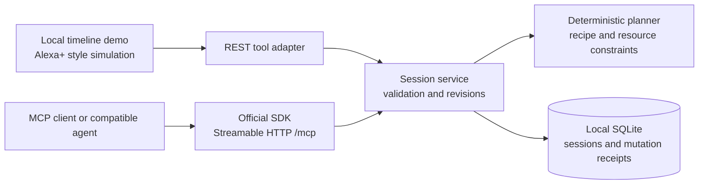

# SimmerShift architecture

SimmerShift treats interrupted dinner as a durable workflow with constraints, dependencies, and progress. Recovery keeps started food, records why the plan changed, and brings the next useful actions forward. A deterministic recipe catalog and scheduler make decisions inspectable without a paid model call.

## Components

| Layer | Responsibility |
| --- | --- |
| Timeline demo | Present a resume briefing, active timers, ready steps, schedule, and recovery journal. |
| HTTP server | Serve the demo and local tool adapter; expose the independent MCP endpoint. |
| MCP adapter | Register structured tool schemas and return readable and structured results using the official SDK. |
| Session service | Validate mutations, enforce revisions, preserve progress, and write sessions atomically. |
| Planner | Schedule remaining work around dependencies/equipment, keeping started food and considering a faster valid base before preparation begins. |
| SQLite store | Persist sessions and idempotency receipts between process runs. |

The official [TypeScript SDK](https://github.com/modelcontextprotocol/typescript-sdk) currently separates the server, client, and Node HTTP adapter into `@modelcontextprotocol/server`, `@modelcontextprotocol/client`, and `@modelcontextprotocol/node`. This build uses server/client 2.3.1 and Node adapter 2.1.1; the lockfile records exact dependency resolution. The server explicitly supports protocol `2025-11-25`.

## Durable state

A cooking session has its own ID and monotonic revision. It stores the pantry, exclusions, serving target, equipment, steps, timestamps, current clock, warnings, and latest changes. SQLite stores a recovery journal alongside the session; `explain_changes` returns its ten most recent entries. Those explanations survive later mutations and server restarts. Steps carry dependencies, resource needs, ingredients, duration, status, and scheduled times. Active steps also carry start and timer timestamps; completed steps carry completion timestamps. The default file is `data/simmershift.sqlite`; `DB_PATH` can select a different local file.

The optional `pause_resume` resume input `interruptionMinutes` adds to a persisted `clockOffsetMs` used for a logical demo clock. It lets a short demo show a longer interruption without waiting in real time. The demo must identify that time advance as simulated.

Workflow pause prevents progress edits; it does not extend active timer deadlines or freeze their displayed countdown. An elapsed timer still needs the person's completion confirmation, so active food continues reserving its equipment. The resume briefing prioritizes active timers, kept progress, then ready actions.

When a burner/oven step is active, resume requires a physical-state report. Omitting it fails atomically with `PHYSICAL_STATE_REQUIRED` (HTTP 409 in the local REST adapter). `heat_unchanged` keeps original deadlines; `heat_changed` resets active heated steps to fresh full-duration estimates at the resumed clock. The engine does not assume how much cooking happened while the heat changed. These steps remain active until manual completion confirmation.

Cooking sessions and MCP HTTP sessions have different lifetimes. SQLite stores the meal workflow. MCP transport sessions are connection state in the running process. After a server restart, the client initializes a new MCP connection and calls `get_session` with the saved cooking session ID. The project does not claim resumable SSE event replay across restarts.

## Mutation guarantees

For each mutation, the service checks the operation and inputs, identifies any prior receipt for the supplied `requestId`, checks `expectedRevision` when provided, calculates the proposed next state, and persists the state with its receipt atomically. A matching retry returns the recorded result. A key reused for a different operation or payload produces an error.

Hard failures do not increment the session revision or persist a half-applied change. Clients should fetch the latest state and choose a new request ID when intentionally changing an operation after a revision conflict. A retry after an ambiguous network response should retain the original request ID and payload.

## Planning decisions

The curated bowl chooses among white rice/couscous, canned or already cooked chickpeas/lentils or tofu, carrot/zucchini/broccoli, and lemon/tomato. Pantry availability and exclusions restrict those choices. Inputs allow 1–6 servings and 1–2 burners. Servings and equipment shape the schedule. The planner keeps finished work, reconciles unfinished work, and reports explanations for ingredient or timing changes. The duration estimates do not cover dry legumes or other rice varieties.

Dependencies are a directed acyclic graph: preparation must precede the step that consumes it, and assembly follows its components. Resource scheduling limits hands-on work and the use of burners or an oven. Passive timers can overlap independent preparation. Starting a step enforces readiness instead of relying on the user interface alone.

Serving time is an explicit target compared with an estimated completion time. Hard conflicts, such as removing every usable component of a required category, are rejected. A late finish is a soft conflict: the estimate remains honest and the session reports the lost time or slack.

Deadline rescue is a constrained recovery decision. If rice is still unstarted, couscous is available and allowed, and changing the base would meaningfully improve an otherwise late finish, the engine can substitute couscous automatically. It compares complete schedules rather than claiming a faster ingredient always saves the meal. Once base preparation has started, the engine keeps that food. A rescue can reduce delay without meeting the serving target; estimates and explanations should say so.

## Transport and local boundary

The [MCP 2025-11-25 transport specification](https://modelcontextprotocol.io/specification/2025-11-25/basic/transports) defines Streamable HTTP and the negotiated protocol header. The project's SDK integration test verifies `2025-11-25` negotiation, discovery, and tool calls. The endpoint uses the SDK's HTTP transport; the web interface's REST adapter is a second access path to the same service.

The intended deployment for this MVP is loopback only. Host and Origin validation protect the local HTTP surface. No remote-user authentication, production deployment, real Alexa+ integration, or cloud resource provisioning is part of the current implementation.

## Entry route and future Alexa+ onboarding

The chosen entry route is the **alternate simulated Alexa+ experience**. The local MCP server supports protocol tests and a reusable tool boundary; this loopback endpoint is not an onboarded Alexa+ add-on.

Amazon's [Alexa+ MCP QuickStart](https://www.developer.amazon.com/docs/alexaplus/add-ons/mcp-toolkit-quickstart.html) requires a remotely accessible endpoint, OAuth 2.1 authorization-code flow with PKCE S256, Protected Resource Metadata and authorization-server metadata, Bearer tokens, and round-trip query latency below 500 ms. A future real integration would need those capabilities plus actual onboarding and client testing. None is claimed here, and no credentials, public tunnel, persistent grants, or cloud authentication service are requested for this simulation build.

## Verification contract

The final local suite passed **45 tests**: 22 planner, 18 service, 4 MCP/HTTP, and 1 actual child-process restart test. It covers dependencies/resources, atomic constraints, duplicate retries, stale revisions, deadline rescue, kept started food, journal persistence, physical-state resume, and explicit completion. The official client demo passed 8 assertions over Streamable HTTP `2025-11-25`. Typecheck, build, and browser-script syntax also passed. Isolated Chrome QA checked the final recovery UI, reload restoration, paused countdowns, changed-heat estimates, and mobile layout. See [VERIFICATION.md](VERIFICATION.md) for results and the distinction between local testing and untested real Alexa+ behavior.
